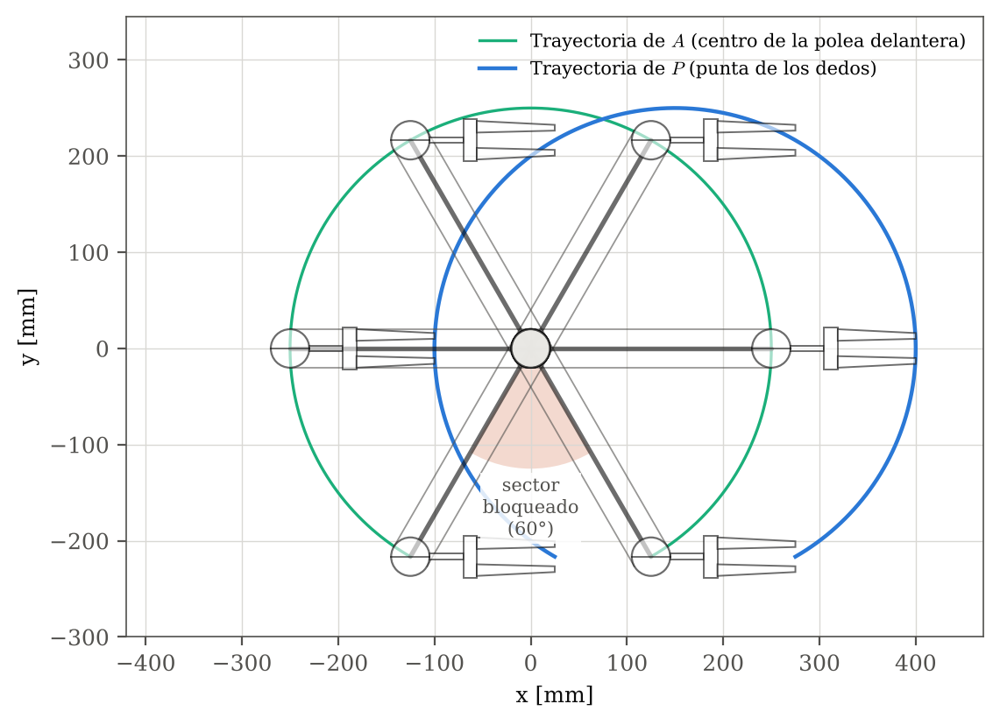
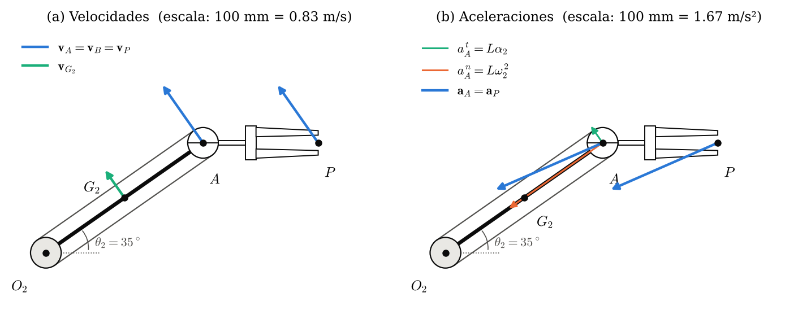
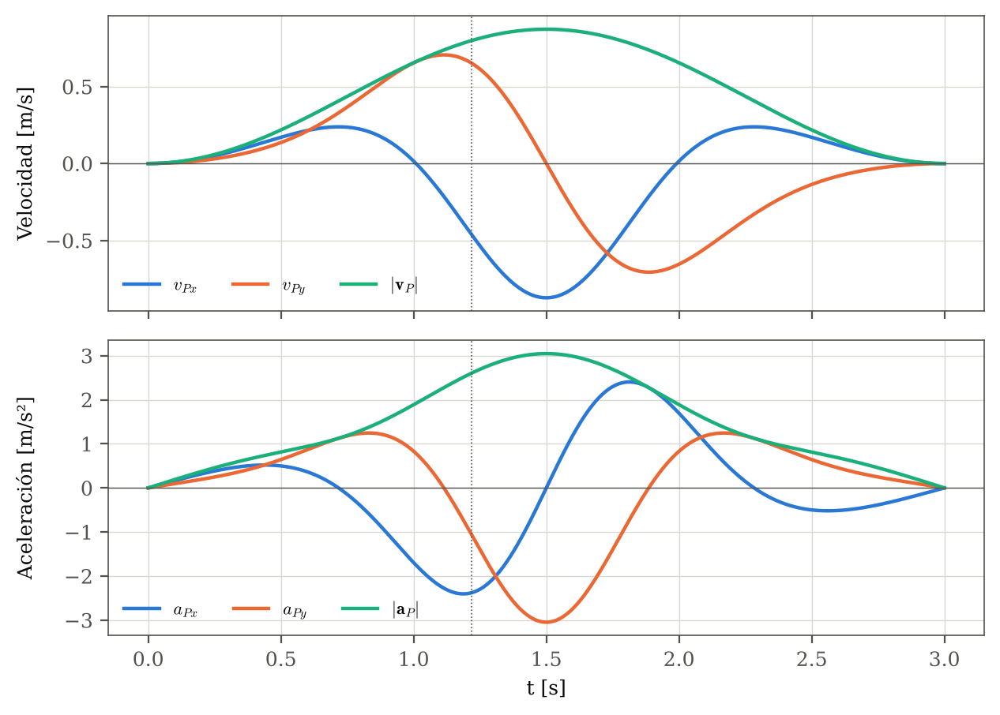

# Proyecto de Mecánica de Maquinaria: brazo con gripper paralelo al suelo

Proyecto práctico de **Mecánica de Maquinaria (ESPOL, PAO II 2026)**.
Autores: Diego Pontón y Joshua Vélez. Profesor: Livinston Castro.

El mecanismo es un **cuatro barras virtual**: un brazo cuyo gripper se mantiene
paralelo al suelo porque una correa, con dos poleas iguales, reemplaza a la
barra superior de un paralelogramo. La polea trasera está fija al chasis y la
delantera va unida al gripper.

| Avance | Contenido | Carpeta |
|---|---|---|
| 3 | Análisis cinemático | [`avance3_analisis_cinematico/`](avance3_analisis_cinematico) |

## Avance 3: análisis cinemático

Todos los cálculos y las gráficas del informe están en Python. El informe
(LaTeX y PDF) toma los números y las figuras directamente de lo que generan los
scripts.

```
avance3_analisis_cinematico/
├── parametros.py          datos del mecanismo y de la maniobra
├── cinematica.py          posición, velocidad y aceleración (método vectorial)
├── posicion_estudio.py    cálculo paso a paso en θ2 = 35°
├── tabla_resultados.py    resultados cada 30° y valores máximos
├── graficas.py            figuras del informe
├── verificacion.py        comprobaciones de los resultados
├── main.py                ejecuta todo
├── resultados/            tabla (CSV y LaTeX) y valores del informe
├── figuras/               figuras en PNG y PDF
└── informe/               informe en LaTeX y PDF
```

### Cómo ejecutarlo

```bash
pip install -r requirements.txt
cd avance3_analisis_cinematico
python main.py
```

Cada script también se puede ejecutar por separado, por ejemplo
`python posicion_estudio.py`. Para regenerar el PDF después de cambiar algún
dato, compila `informe/Avance3_Analisis_Cinematico.tex` desde la carpeta
`informe/`.

### Datos

| Símbolo | Descripción | Valor |
|---|---|---|
| L | Distancia entre ejes de las poleas (brazo y correa) | 250 mm |
| d = r | Radio de las poleas | 20 mm |
| e | Eje delantero a la punta de los dedos (P) | 150 mm |
| θ1 | Orientación de la bancada | 90° |
| θ2 | Rango de trabajo del brazo | −60° a 240° |
| T | Duración de la maniobra (ley cicloidal, supuesta) | 3 s |

Los datos se cambian en `parametros.py`.

### Método

1. **Posición:** ecuación de lazo `r2 + r3 = r1 + r4` y relación de la banda
   con el brazo como referencia, `(ω3 − ω2)/(ω1 − ω2) = r1/r3 = 1`.
   Resultado: θ3 = 90° (el gripper no rota) y θ4 = θ2.
2. **Velocidad:** `v_B = v_A + ω × r_B/A`, resuelta por componentes x, y.
   Resultado: ω3 = 0 y ω4 = ω2.
3. **Aceleración:** `a_B = a_A + α × r_B/A − ω² r_B/A`, sin Coriolis porque no
   hay deslizamiento. Resultado: α3 = 0 y α4 = α2.
4. **Maniobra:** el brazo recorre 300° en 3 s con una ley cicloidal.

### Resultados principales

- El gripper se traslada sin rotar: todos sus puntos tienen la velocidad y la
  aceleración del centro de la polea delantera.
- En θ2 = 35°: |v_P| = 0.798 m/s y |a_P| = 2.599 m/s².
- Máximos, con el brazo vertical: ω2 = 3.491 rad/s, |v_P| = 0.873 m/s y
  |a_P| = 3.046 m/s².







### Verificaciones (`verificacion.py`)

- La barra virtual mide L y θ4 = θ2 en todo el rango.
- Si se resuelven ω3 y ω4 sin usar la banda, se obtiene ω3 = 0 y ω4 = ω2,
  excepto con el brazo vertical (θ2 = 90°). Ahí el sistema es indeterminado y
  la banda define la solución.
- Al derivar numéricamente la posición de P, el error frente a las expresiones
  analíticas es de 5×10⁻⁷ m/s en velocidad y 5×10⁻⁶ m/s² en aceleración.
